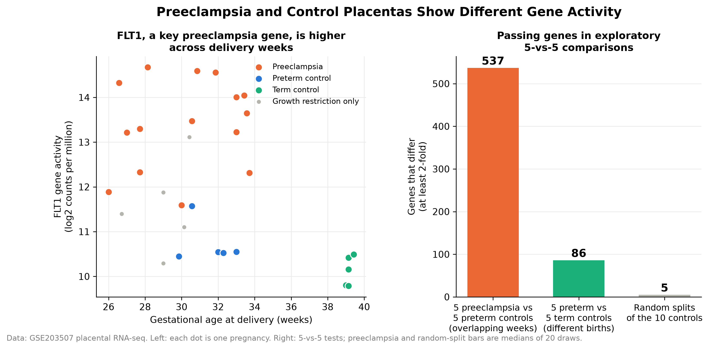

# [Team Name]: Not Just Born Too Soon

**How much of the early-onset preeclampsia placenta signature is delivery timing, and which cells carry the rest?**

OpenBio 2026 Datathon, Track 1: Maternal-Fetal Cell Communication in Preeclampsia



## Team

| Name | Role |
|---|---|
| [Name] | [Role, e.g. analysis lead] |
| [Name] | [Role, e.g. biology and hypothesis] |
| [Name] | [Role, e.g. article and video] |

## Research Question

Starter questions 6 and 9. In villous placenta from early-onset preeclampsia, (Q6) how much of the gene-activity difference from control placentas is explained by gestational age at delivery, and (Q9) are the genes that remain normally expressed across the placenta or concentrated in specific cell types?

## Data Used

- [x] GSE203507 bulk RNA-seq, villous tissue, 30 pregnancies (required)
- [x] Zeisel/Admati gene browser: LEP, FLT1, HTRA4, PAPPA2, ENG, HSD17B1, HLA-G (required, seven genes)
- [x] Admati/Skarbianskis single-cell pseudobulk files (optional extension; used as a healthy reference and for within-cell-type comparisons)
- [x] Other public data: MSigDB Hallmark gene sets v7.0, via the [GSEApy test-data mirror](https://github.com/zqfang/GSEApy/tree/master/tests/extdata) (checksum-verified in the notebook)

## How to Run

Everything is in one notebook: `notebooks/track01_analysis.ipynb`. The datathon data package is included in `data/`, so the repository runs on its own.

```bash
git clone --branch integrate-track01-analysis https://github.com/sanjnabandaru/track-01.git
cd track-01
python3.11 -m venv .venv && source .venv/bin/activate     # CPython 3.11.8 used for the submitted run
pip install -r requirements.txt
cd notebooks
jupyter nbconvert --to notebook --execute track01_analysis.ipynb --inplace   # or open it and Run All
```

On Google Colab, open `notebooks/track01_analysis.ipynb` from this branch and run all cells. The first cell clones the branch and installs `requirements.txt`.

Reproducibility details:

- The notebook follows the official seven-step workflow (its introduction maps each step to a section) and produces every number and figure in the article, analysis plan and hypothesis card. `notebooks/track01_analysis.py` holds the same code as a plain script.
- Browser notes read by the notebook: `notebooks/inputs/track01_browser_lookups.csv`. They record which cell types express each gene; they are qualitative, not donor-level validation.
- Environment: every package pinned in `requirements.txt`. The notebook was rerun from scratch in a fresh CPython 3.11.8 virtual environment with no errors. It takes about 15 minutes on 8 cores; set `RUN_SLOW = False` to skip the leave-one-out and permutation loop.
- Random seed: 2026 (permutations, random draws and null gene sets). Small numerical differences can remain across environments.
- Internet is needed once for Hallmark v7.0 (about 50 KB, checksum-verified, not redistributed here). A local `data/track01_gene_sets.gmt` must match that exact checksum; the official `data/get_gene_sets.py` downloads a different release.

## Files

| Path | Contents |
|---|---|
| `notebooks/track01_analysis.ipynb` | The analysis, executed, with outputs |
| `notebooks/track01_analysis.py` | Same code as a script |
| `notebooks/inputs/track01_browser_lookups.csv` | Zeisel/Admati browser notes (seven genes) |
| `notebooks/results/` | All result tables |
| `figures/` | All graphs, including `headline.png` |
| `docs/article.md` | Science communication article ([HUDP guide](https://github.com/Harvard-Undergraduate-OpenBio/openbio-datathon-2026/blob/main/docs/article-guide.md)) |
| `docs/analysis-plan.md` | Comparisons, models, thresholds and confounders |
| `docs/hypothesis-card.md` | Hypothesis and how to test it |
| `docs/presentation-script.md` | Five-minute talk script |
| `docs/rubric-checklist.md` | Where each rubric requirement is met |
| `requirements.txt` | Pinned Python packages |
| `data/`, `TRACK01_GUIDE.md`, `1-setup.md` to `4-submit.md`, `reference/`, `templates/`, `notebooks/track01_workflow.Rmd` | The organizers' data package, track materials and R template, unchanged except setup notes |

## Key Findings

- **Q6, delivery timing:** comparing 15 PE placentas with the 10 preterm placentas without PE, adjusted for delivery week, growth restriction and fetal sex, finds **190 genes** (156 higher, 34 lower). Adding timing to the model changes the estimated PE effects by a median **8%** (term indicator) or **2%** (linear weeks) across 266 genes. These are model-dependent summaries, not a causal fraction.
- **Control choice:** in one model, PE vs term controls gives 334 genes and PE vs spontaneous preterm controls 316; 164 are shared, and fold changes agree (r = 0.83, 97% same direction). A study with only term controls would attribute a median 25% of each difference to timing.
- **Q9, cell types:** 70 of 116 PE-up genes peak in a trophoblast class in healthy reference donors. Donor-level pseudobulk analyses suggest a syncytiotrophoblast signal, but small groups and cell mixture limit localization.
- **Hypothesis:** hypoxia-response genes are enriched, and the cross-validated score is about 2.5x higher in PE in this dataset. A non-significant delivery-week slope does not establish that timing has no effect; the proposed mechanism needs independent testing.

## Limitations

- Small groups: 15 PE, 10 preterm non-PE and 5 term placentas; single-cell controls 6 (late) and 3 (early).
- Timing modelled as a line and as a term switch; curved effects within 26 to 34 weeks cannot be ruled out.
- Labour, delivery mode and medications are not recorded in the bulk data. Single-cell checks and an FGR-only control model address this only partly.
- Bulk tissue mixes cell types; cell-type assignment relies on another study.
- Tissue taken at delivery shows association, not cause.

## Presentation

Video link: [add your unlisted YouTube link]

## Data Sources

1. Ackerman WE, Buhimschi IA, Buhimschi CS, et al. Molecular subphenotyping using placental transcriptomics in early-onset preeclampsia and fetal growth restriction. NCBI GEO [GSE203507](https://www.ncbi.nlm.nih.gov/geo/query/acc.cgi?acc=GSE203507).
2. Admati I, Skarbianskis N, et al. Placenta PE single-cell RNA-seq dataset. Figshare, [doi:10.6084/m9.figshare.23264102.v1](https://doi.org/10.6084/m9.figshare.23264102.v1) (CC BY 4.0). Paper: Admati I, Skarbianskis N, Hochgerner H, et al. Two distinct molecular faces of preeclampsia revealed by single-cell transcriptomics. *Med* 4(10):687-709 (2023), [doi:10.1016/j.medj.2023.07.005](https://doi.org/10.1016/j.medj.2023.07.005).
3. Zeisel lab placenta PE gene browser. https://storage.googleapis.com/www_zeisellab/PE_web/pe_web_test_v1.html
4. Liberzon A, et al. The Molecular Signatures Database Hallmark gene set collection. *Cell Systems* 1(6):417-425 (2015). [doi:10.1016/j.cels.2015.12.004](https://doi.org/10.1016/j.cels.2015.12.004)
5. Muzellec B, Teleńczuk M, Cabeli V, Andreux M. PyDESeq2: a python package for bulk RNA-seq differential expression analysis. *Bioinformatics* 39(9) (2023). [doi:10.1093/bioinformatics/btad547](https://doi.org/10.1093/bioinformatics/btad547)
