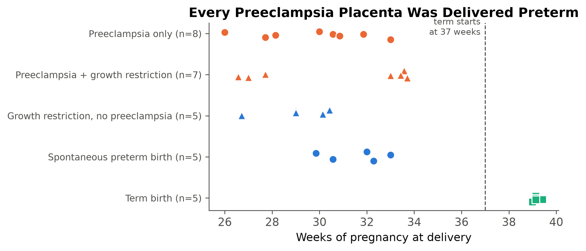
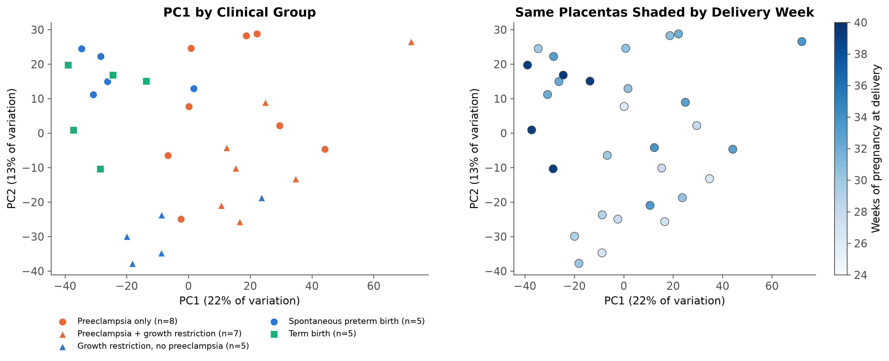
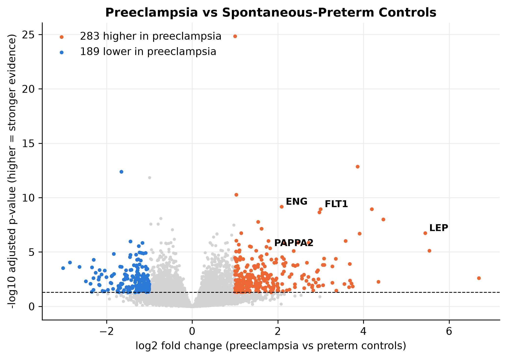
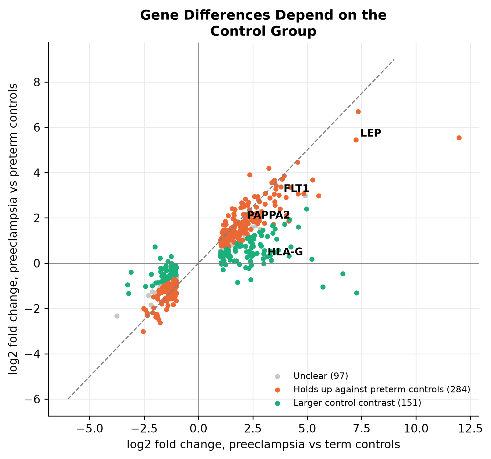

# Not Just Born Too Soon

**Comparing preeclampsia placentas with preterm controls reveals gene-expression differences, but cannot eliminate every effect of delivery timing.**

By Reads between the Lines ([team member names]) | OpenBio 2026 Datathon, Track 1

**Figure 1.** Each dot represents one placenta. The bars summarize exploratory comparisons of five samples per group; the preeclampsia and random-split bars are medians over 20 draws. Different delivery circumstances can affect the control comparison, so it is not a measurement of timing alone. Source: [GSE203507](https://www.ncbi.nlm.nih.gov/geo/query/acc.cgi?acc=GSE203507).

## Why delivery timing matters

Preeclampsia is a pregnancy complication involving high blood pressure and sometimes injury to organs. In early-onset cases, delivery may be necessary well before the due date. Researchers studying a placenta collected at delivery therefore face a difficult question: are differences in gene activity related to preeclampsia, the stage of pregnancy, or other differences between deliveries?

We asked how the choice of control group changes the placental gene-expression differences observed in early-onset preeclampsia. A gene's measured activity is an RNA count, not a direct measurement of the protein it produces.

## The data and our approach

We analyzed the released villous-tissue counts and clinical information for 30 pregnancies from [GSE203507](https://www.ncbi.nlm.nih.gov/geo/query/acc.cgi?acc=GSE203507): 15 with early-onset preeclampsia, 5 spontaneous-preterm controls, 5 term controls, and 5 with fetal growth restriction without preeclampsia. Our primary comparison uses the 15 preeclampsia samples and 5 spontaneous-preterm controls. It is an exploratory comparison of overlapping delivery weeks, not individually matched pregnancies. We count each pregnancy once and use [PyDESeq2](https://doi.org/10.1093/bioinformatics/btad547) to compare gene counts.

The dataset is small, tissues were collected at delivery, and the control groups differ in delivery circumstances. These constraints limit what the comparison can tell us about cause.

## What we found

### The comparison is not between identical pregnancies

**Figure 2.** Delivery weeks differ across groups. The preeclampsia and spontaneous-preterm groups overlap, but are not individually matched. Each point is a pregnancy. Source: GSE203507.

We first summarized overall gene activity with *principal component analysis* (PCA), a way to place samples with similar patterns closer together. PCA is a summary, not a test of what caused the patterns.

**Figure 3.** The same placentas are shown by clinical group and by delivery week. The axes summarize the largest patterns in the measured gene counts. Source: GSE203507.

### Differences remain against preterm controls

In the primary two-group model, 472 genes passed: 283 had higher and 189 had lower estimated expression in preeclampsia. A gene passes if its estimated difference is at least twofold and its adjusted p-value is below 0.05. The adjustment accounts for testing many genes. Passing the threshold indicates statistical evidence in this dataset; it does not prove a gene caused preeclampsia.

**Figure 4.** Each point is a gene. The horizontal axis shows estimated fold change on a log2 scale; the vertical axis summarizes statistical evidence after adjustment. Highlighted genes pass the notebook's thresholds. Source: GSE203507.

In a separate three-group model, 532 genes passed for each preeclampsia comparison, with 240 shared. That fit shares information across groups, so its counts should not be treated as repeat runs of the primary two-group model.

**Figure 5.** Each point is a gene selected in the preeclampsia-versus-term comparison. Categories describe the observed contrasts; they cannot identify a causal timing effect. Source: GSE203507.

The notebook's exploratory five-versus-five resampling and covariate checks provide context for the small control groups. They do not prove that timing is unimportant: spontaneous-preterm and term births can differ for reasons other than delivery week.

### Where might these genes be active?

Whole-tissue measurements combine different placental cells. The notebook includes qualitative gene-browser notes for FLT1, ENG, PAPPA2, LEP and HLA-G. These notes must be independently checked before submission. Even if confirmed, a browser pattern provides context rather than proof that a bulk difference occurred within a particular cell type.

## Unanswered questions

With five controls per group, the study may miss real differences. The controls are not individually matched, and spontaneous-preterm delivery can involve inflammation or other circumstances different from medically indicated delivery. Tissue collected at delivery cannot determine whether a gene-expression difference preceded the disease or followed it. Bulk measurements also cannot separate changes inside cells from changes in the proportions of cell types.

## Conclusion and next steps

The data show gene-expression differences between preeclampsia and spontaneous-preterm placentas in this sample. The size of any independent timing contribution remains uncertain.

Our hypothesis is that some placental gene-expression differences, including higher FLT1 RNA, will also be observed in a larger early-onset preeclampsia cohort with carefully characterized preterm controls. A follow-up should compare groups while recording gestational age, delivery mode and labour, and measure FLT1 RNA and the protein product separately. If the differences do not replicate after those comparisons, the hypothesis would be weakened.

## Data, code and credits

The [repository](https://github.com/sanjnabandaru/track-01) contains the [notebook](../notebooks/track01_workflow.ipynb), released inputs, results and figure-generation code. Data: [GSE203507](https://www.ncbi.nlm.nih.gov/geo/query/acc.cgi?acc=GSE203507). Cell-type context: [Zeisel/Admati gene browser](https://storage.googleapis.com/www_zeisellab/PE_web/pe_web_test_v1.html). Analysis software: [PyDESeq2](https://doi.org/10.1093/bioinformatics/btad547).

Thanks to the data contributors and the OpenBio organizers for the released data package and workflow. [Add team acknowledgements.]
