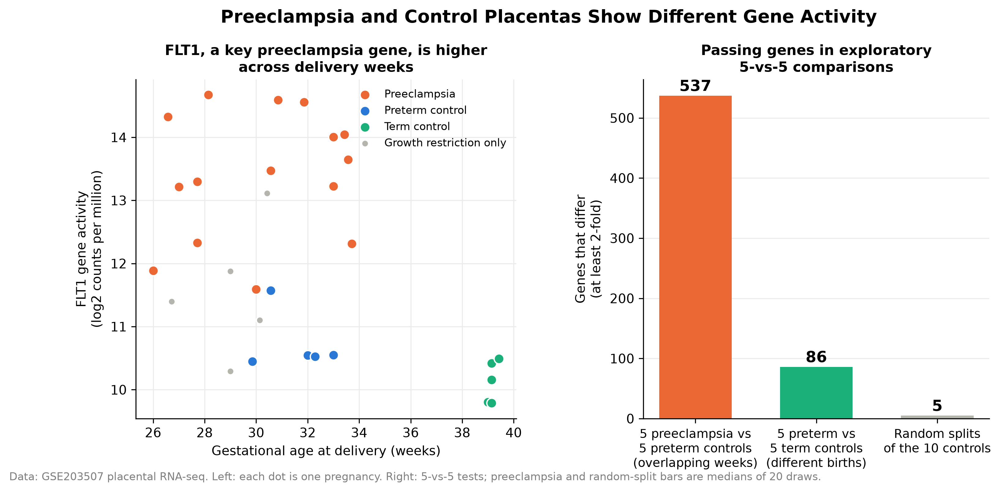
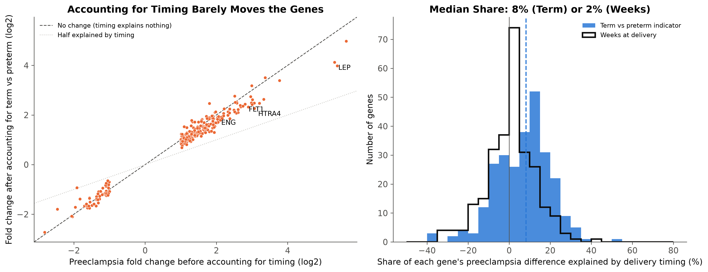
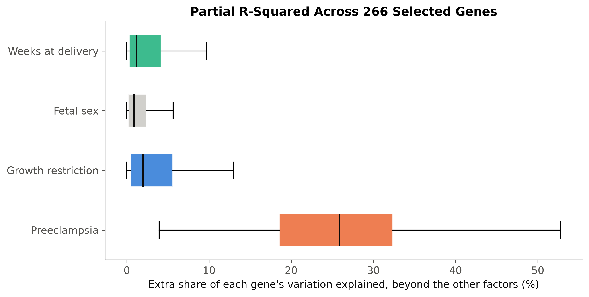
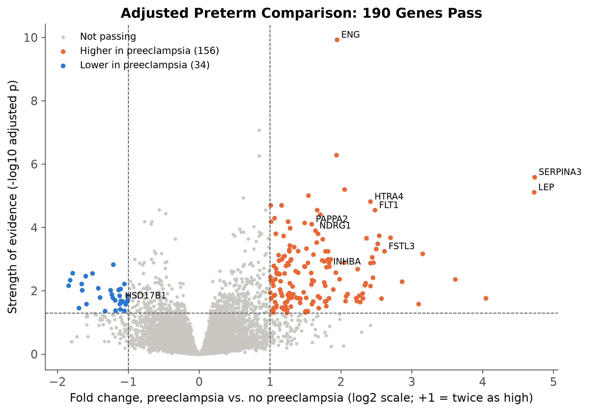
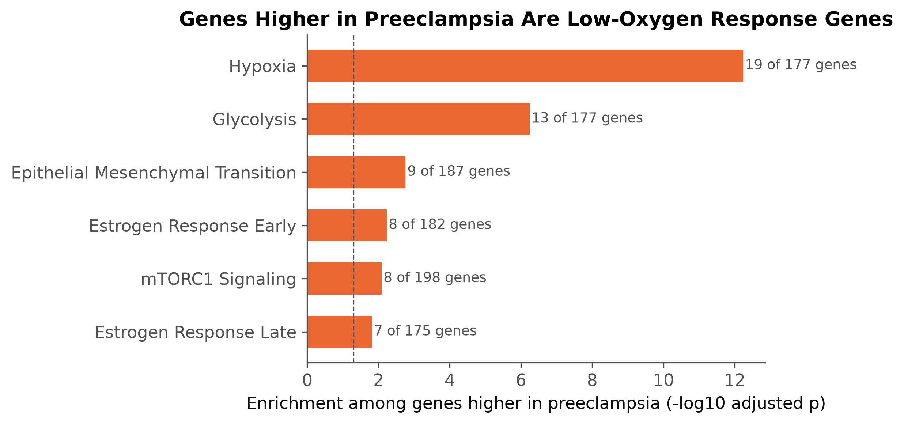
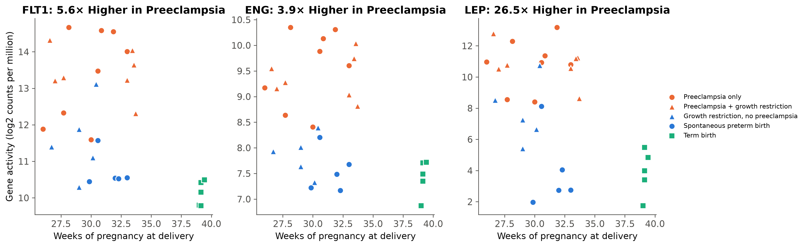
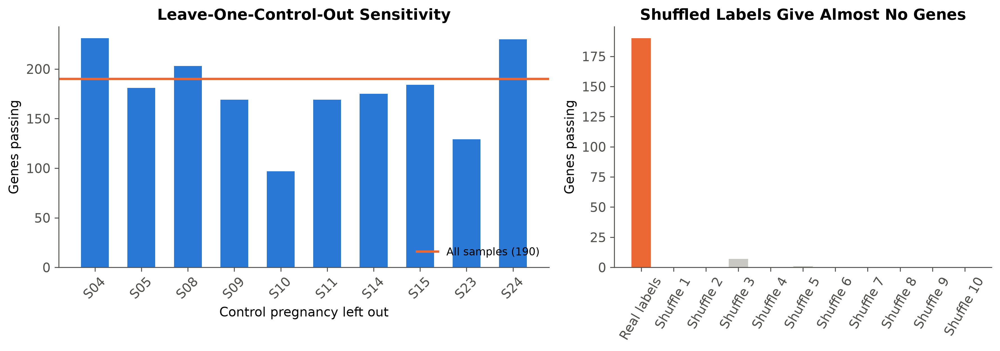
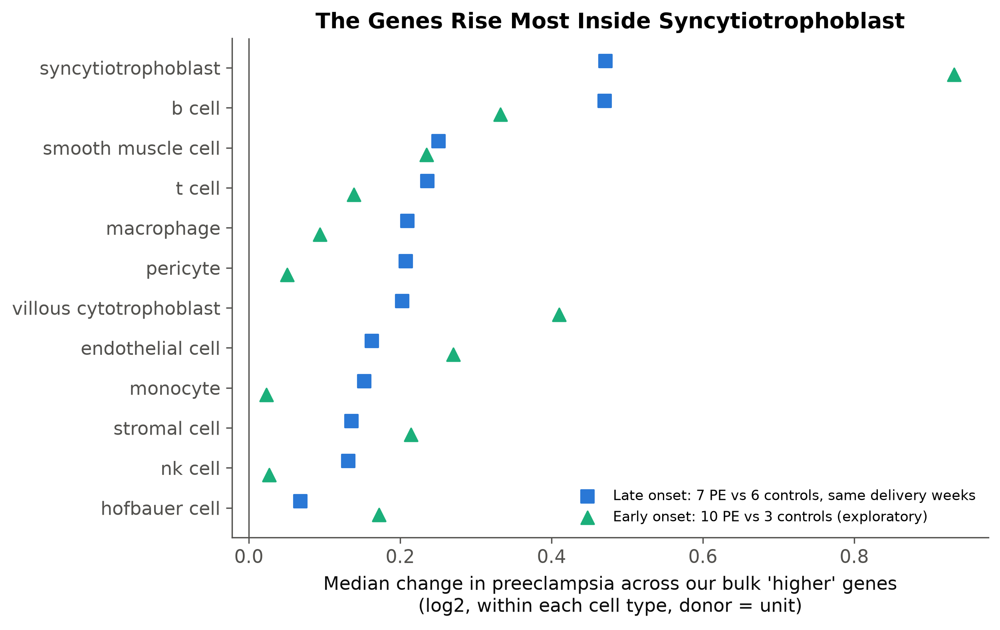

# Not Just Born Too Soon

**Placentas from early preeclampsia show gene-expression differences even when compared with preterm controls. An exploratory analysis points to a possible low-oxygen response in placental cells.**

By [Team member names], OpenBio 2026 Datathon, Track 1

Figure 1. Each point is one placenta. In this exploratory analysis, the estimated hypoxia-response score is about 2.5 times higher in preeclampsia than in preterm non-PE placentas. Genes for each preterm placenta's score were selected without that placenta. The delivery-week slope was not statistically significant; this does not prove that timing has no effect. (Data: [GSE203507](https://www.ncbi.nlm.nih.gov/geo/query/acc.cgi?acc=GSE203507).)

## Introduction

Preeclampsia is a pregnancy complication in which the mother's blood pressure rises to dangerous levels, often with damage to the kidneys, liver or brain. It affects about 2 to 8 of every 100 pregnancies, and the only cure is to deliver the placenta. When it starts before 34 weeks, doctors often have to deliver a very premature baby to protect the mother.

The disease is thought to start in the placenta, which releases proteins into the mother's blood that harm her blood vessels. One of them, sFlt-1, is already measured in clinics to predict preeclampsia ([Zeisler et al. 2016](https://doi.org/10.1056/NEJMoa1414838)).

Studying these placentas has a built-in trap. Because preeclampsia forces early delivery, an affected placenta is usually also a *younger* placenta. Any difference we see could come from the disease or simply from the stage of pregnancy. So we asked two questions:

1. **How much of the difference between preeclampsia and control placentas is just delivery timing?**
2. **Are the genes that remain switched on all over the placenta, or concentrated in particular cells?**

## The Data and Our Methods

We used a public study of 30 placentas collected at delivery ([GSE203507](https://www.ncbi.nlm.nih.gov/geo/query/acc.cgi?acc=GSE203507)): 15 with early preeclampsia (7 also with fetal growth restriction), 5 with growth restriction only, 5 spontaneous preterm births and 5 term births. RNA sequencing measured gene activity in whole tissue. The [core workflow](../notebooks/track01_workflow.ipynb) compares PE with spontaneous preterm controls; the [exploratory companion](../notebooks/track01_analysis.ipynb) also uses FGR-only controls in an adjusted model. We use a second study of 86,752 cells from 26 donors ([Admati, Skarbianskis et al. 2023](https://doi.org/10.1016/j.medj.2023.07.005)) for cell-type context. **Groups are small, tissue was taken at delivery, and labour, delivery method and medications were not recorded in the main study.**

## What We Found

### Question 6: comparing delivery timing

**The comparisons.** Our main comparison sets the 15 PE placentas against the 10 preterm placentas without preeclampsia (5 spontaneous preterm births and 5 with growth restriction only), adjusting for delivery week, growth restriction and fetal sex. Delivery weeks overlap but are not individually matched, so timing and other confounding may remain.

Does the choice of control group matter? In one model, PE vs term controls gives 334 genes and PE vs spontaneous preterm controls gives 316, but only 164 are on both lists. Across all genes on either list, the fold changes agree well (correlation 0.83, 97% in the same direction), so the direction of the preeclampsia signal holds while the exact gene list shifts.

We also summarized 15,835 filtered genes with principal component analysis (PCA), which places placentas with similar overall gene activity close together.

Figure 2. The main axis of variation between placentas (PC1, 22% of all variation) separates preeclampsia (orange) from controls. Shading by delivery week is shown on the right. (Data: GSE203507.)

PC1 was associated with preeclampsia (p = 0.00004); its association with delivery week was not statistically significant (p = 0.14). This does not establish that delivery timing has no effect.

**An exploratory model comparison.** For genes selected by one model, we compared estimated PE effects with and without a timing covariate, using either delivery weeks or a term/preterm indicator. Both models adjusted for growth restriction and fetal sex. These model-dependent changes are not a causal measurement of the share due to timing.

Figure 3. Left: each dot is a gene, comparing its estimated effect with and without a timing covariate. Right: the model-dependent change in that estimate. (Data: GSE203507.)

Across 266 selected genes, adding timing changed the estimated PE effect by a median **8%** with the term indicator and **2%** with linear weeks. Only 1 gene lost more than half its estimated difference, and every gene kept its direction. These summaries depend on the selected genes and model assumptions.

Figure 4. For the genes that differ in preeclampsia, how much of their variation each factor explains beyond the others. (Data: GSE203507.)

**The main preterm model.** We compared the 15 PE placentas with the 10 non-PE preterm placentas, adjusting for delivery weeks, FGR and fetal sex. We counted a gene as different if it changed at least 2-fold with adjusted p below 0.05.

Figure 5. The main adjusted PE-vs-preterm model. Genes to the right are higher in PE; higher points show stronger evidence. 156 genes are higher and 34 lower. (Data: GSE203507.)

This adjusted preterm model found 190 genes. A separate term-vs-spontaneous-preterm control comparison found 90, with 4 shared. The latter contrast may reflect delivery circumstances as well as timing, and overlapping significance lists cannot cleanly divide genes into disease and timing categories.

To explore power, 20 random splits of the controls yielded 0 to 26 passing genes, while 20 draws of 5 PE versus 5 preterm controls yielded 185 to 620. These small exploratory checks do not rule out missed timing effects.

In an exploratory decomposition of the PE-vs-term contrast, the median timing-related component was 25%. This is model-dependent, not a causal estimate. HLA-G illustrates why the choice of control group matters (Figure 7).

### What the disease genes do

The 156 rising genes overlap most with the standard "hypoxia" gene list, the alarm cells sound when they are short of oxygen (19 genes; the chance of an overlap this large by luck is far below 1 in a billion), followed by glycolysis, a way of making energy without oxygen ([MSigDB Hallmark sets](https://doi.org/10.1016/j.cels.2015.12.004)).

Figure 6. Biological processes most over-represented among genes higher in preeclampsia. (Data: GSE203507 and MSigDB Hallmark.)

FLT1, the gene behind the sFlt-1 blood test, has an estimated 5.6-fold higher RNA level (95% confidence interval 3.0 to 10.3), ENG 3.9-fold (2.7 to 5.4), and LEP 26-fold (9 to 79), in the main preterm model. RNA levels do not directly measure the proteins in blood.

Figure 7. FLT1, ENG, LEP and HLA-G in each placenta against delivery week. HLA-G illustrates sensitivity to the control group; the plot alone cannot establish cause. (Data: GSE203507.)

This fits a long-standing idea: the arteries feeding the placenta do not widen properly in early pregnancy, so the placenta is under-supplied with oxygen. Laboratory work shows that low oxygen raises FLT1 in human placental tissue through an oxygen-sensing switch called HIF-1 ([Nevo et al. 2006](https://doi.org/10.1152/ajpregu.00794.2005)) and raises leptin in placental cells ([Mise et al. 1998](https://doi.org/10.1210/jc.83.9.3225)). FLT1, ENG and LEP are not on the standard hypoxia list, yet within the 15 preeclampsia placentas they rise and fall closely with the hypoxia genes (rank correlations of 0.89, 0.84 and 0.79, where 1 is a perfect match).

**Our headline graph (Figure 1)** scores preterm placentas using hypoxia genes selected from the other 24 (*cross-validation*). The estimated group difference is about 2.5-fold (95% confidence interval 1.7 to 3.8). Cross-validation reduces one source of selection bias but does not replace testing in an independent cohort.

### How sure are we?

When we shuffled the preeclampsia labels at random ten times, almost no genes passed instead of 190. When we left out each control placenta in turn, the result held. When we dropped S01, the one placenta far from all others in the PCA, 178 genes passed and every gene kept its direction. When we dropped placentas with odd blood pressure records or poor data quality, used only spontaneous preterm births as controls, or added maternal age and sequencing depth, every gene kept its direction.

Figure 8. Left: genes passing when each preterm control is left out. Right: real labels vs randomly shuffled labels. (Data: GSE203507.)

One worry we could only partly address: spontaneous preterm births usually involve labour, while preeclampsia babies are mostly delivered by planned caesarean. Comparing preeclampsia only with growth-restriction placentas, which are also mostly caesarean, kept every gene's direction, with effects about 70% as large. With just 5 controls, few genes reached significance on their own (11 of 190).

### Question 9: the genes are concentrated in trophoblast

Next we asked where these genes are normally made, using only the *healthy* donors of the single-cell study. For each gene we computed a *specificity score* from 0 (made equally by every cell type) to 1 (made by only one).

Figure 9. Left: how concentrated each set of genes is in healthy placenta. Right: the cell type where each gene peaks, for genes higher in preeclampsia (orange) and all genes (grey). (Data: [Admati, Skarbianskis et al.](https://doi.org/10.6084/m9.figshare.23264102.v1), healthy donors.)

The preeclampsia genes are **concentrated, not broad**: median specificity 0.69, against 0.31 for random genes with similar activity levels. And they are concentrated in one family of cells. 70 of 116 rising genes peak in *trophoblast*, the placenta's own specialized cells, compared with 30% of all genes. Pregnancy-stage genes are also fairly specific, but they show no such preference for trophoblast. Two trophoblast types dominate: extravillous trophoblast, which invades the uterine wall, and syncytiotrophoblast, the single giant cell layer that covers the placenta and is bathed in the mother's blood.

**Which cell changes in preeclampsia?** Being made by a cell type is not the same as changing in it. We compared donor-level pseudobulk expression within each cell type. Late-onset donors had overlapping delivery weeks (37 to 40), reducing but not eliminating timing differences.

Figure 10. How much our rising genes go up in preeclampsia donors inside each cell type of the single-cell study. Squares: late-onset donors matched on delivery week. Triangles: early-onset donors, only 3 controls, so exploratory. (Data: Admati, Skarbianskis et al.)

Syncytiotrophoblast tops both exploratory comparisons: 81% of the genes are higher in late-onset preeclampsia and 96% in early-onset. Subset checks for delivery method and magnesium sulfate are limited by small donor numbers. These findings are consistent with a within-cell-type signal but do not exclude cell-mixture effects.

The gene browser fits this picture: LEP appears almost only in syncytiotrophoblast, and FLT1, HTRA4 and PAPPA2 are mostly trophoblast genes. ENG is made by many cell types, so we cannot place it. The browser has no legend for its preeclampsia and control markers, so we used it only to see which cells make each gene, not as evidence of change.

## Unanswered Questions

- **Curved timing effects.** We modelled timing as a straight line and as a term vs preterm switch. A curved effect within 26 to 34 weeks would need more preterm controls to detect.
- **Which trophoblast?** Several genes, including FLT1, are made in the largest amounts per cell by extravillous trophoblast, and the healthy profile for that cell type rests on only 3 donors.
- **Cause or consequence?** An oxygen-starved placenta could help cause high blood pressure, or high blood pressure could starve the placenta. Tissue taken at delivery cannot separate the two.
- **Labour.** Our best proxy (growth-restriction controls) kept the direction of every gene but had too few placentas to be conclusive.

## Conclusions, Limitations and Next Steps

PE and preterm placentas without PE differ in gene expression even after adjusting for delivery week, growth restriction and fetal sex. Further analyses suggest a trophoblast-associated hypoxia-response program, but cannot establish how much timing causes the differences or pinpoint their cellular origin.

**Our hypothesis:** in early-onset preeclampsia, syncytiotrophoblast responds to low oxygen through HIF, raising FLT1, ENG, leptin and related genes. This proposed mechanism and its relationship to delivery timing require independent testing.

**Limitations:** 15 preeclampsia, 10 preterm and 5 term placentas; bulk tissue that mixes cell types; cell-type assignments from a different study with small control groups; no record of labour, delivery method or medications in the main study; and association, not cause.

**Next steps:** (1) Test the same score in a larger public placenta collection that records delivery method and labour, such as GSE75010 (157 placentas). (2) Stain tissue for FLT1, LEP and a hypoxia marker alongside markers of each trophoblast type. (3) Grow placental cells at low and normal oxygen with HIF blocked. If blocking HIF does not stop FLT1 and leptin from rising, our hypothesis is wrong.

## Data and Code

- Repository: [github.com/sanjnabandaru/track-01, branch integrate-track01-analysis](https://github.com/sanjnabandaru/track-01/tree/integrate-track01-analysis)
- Analysis notebook: [`notebooks/track01_analysis.ipynb`](../notebooks/track01_analysis.ipynb)
- Bulk placenta data: Ackerman WE, Buhimschi IA, Buhimschi CS, et al. NCBI GEO [GSE203507](https://www.ncbi.nlm.nih.gov/geo/query/acc.cgi?acc=GSE203507)
- Single-cell data: Admati, Skarbianskis et al., [Figshare 23264102](https://doi.org/10.6084/m9.figshare.23264102.v1) (CC BY 4.0), as prepared in the [OpenBio datathon data package](https://github.com/Harvard-Undergraduate-OpenBio/openbio-datathon-2026/tree/main/track-01/data)
- Gene browser: [Zeisel lab placenta PE browser](https://storage.googleapis.com/www_zeisellab/PE_web/pe_web_test_v1.html)
- Gene sets: [MSigDB Hallmark](https://doi.org/10.1016/j.cels.2015.12.004)

No personally identifiable data are included; all datasets are public and de-identified.

## Acknowledgements

Thanks to [teammate name], whose parallel analysis contributed the noise and power check, the term-only comparison and the HLA-G example, and to [teammate 3 name] for the gene-overlap and outlier checks and the more careful reading of the gene browser. Thanks to the Harvard Undergraduate OpenBio organizers for the curated data package and workflow, to the authors of GSE203507 and of the Admati/Skarbianskis single-cell study for sharing their data, to the Zeisel lab for the gene browser, and to the Harvard Undergraduate Data Project for the article guide.
